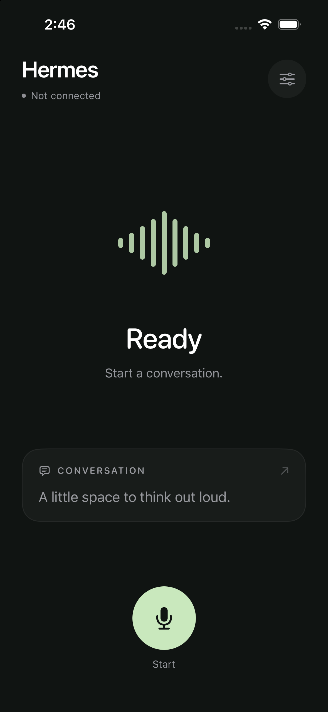
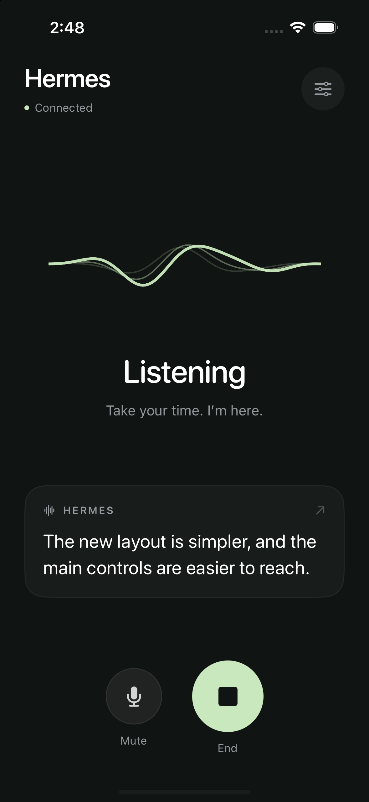

# Hermes Voice iOS

A minimal native iPhone and CarPlay voice client for a dedicated [Hermes Agent](https://github.com/NousResearch/hermes-agent) profile. Talk through a private Tailscale connection, with ElevenLabs speech recognition and voice output. Incoming agent calls use CallKit and PushKit; no phone number is required.

<p align="center">
  
  
  
</p>

*Actual SwiftUI app captures from the iPhone 15 simulator. Conversation text and listening state use a debug-only synthetic fixture; no microphone, provider call or private conversation is used. [Reproduce the screenshots](docs/screenshots.md).*

## Features

- Continuous conversation, live transcript, audio-reactive waveform, mute and interruption handling.
- A dedicated Hermes voice profile instead of a second conversational agent relaying each request.
- Native CarPlay voice controls sharing the iPhone's current session.
- CallKit integration: answer an incoming call and open Hermes to the ongoing session.
- A private attention queue for agents. Calls require owner opt-in, a fresh driving signal, an urgent decision due within 30 minutes, and push availability. Offers are deduplicated and rate limited.
- A Shortcuts action, **Set Hermes Driving Status**, for CarPlay connect/disconnect automations.

## Requirements

- iOS 26.4 or later; Xcode with the corresponding SDK and XcodeGen.
- A Mac running Hermes Agent with a dedicated `voice` profile and its native API.
- Tailscale on the host and iPhone; HTTPS access through Tailscale Serve.
- An ElevenLabs API key with speech recognition and synthesis permissions.
- Apple signing/provisioning supporting CarPlay Voice Based Conversation and push notifications. APNs credentials and a physical iPhone are required for incoming calls.

## Build

```sh
cp Local.xcconfig.example Local.xcconfig
# Set your Apple team in Local.xcconfig. The optional private URL stays local.
xcodegen generate
open HermesVoice.xcodeproj
```

The app's existing bundle identifier is `com.perryraskin.hermes.voice`. If you change it, update the Keychain service identifier, URL type, signing settings and APNs topic together. `Release` includes CarPlay and push; `PhonePreview` includes push without the CarPlay entitlement.

Simulator build:

```sh
xcodebuild -project HermesVoice.xcodeproj -scheme HermesVoice \
  -sdk iphonesimulator -derivedDataPath /tmp/hermes-voice-build \
  CODE_SIGN_IDENTITY=- CODE_SIGNING_ALLOWED=YES build
```

## Private voice service

```sh
python3 -m venv .venv
.venv/bin/pip install -r server/requirements.txt
mkdir -p ~/.config/hermes-voice
cp server/service.example.json ~/.config/hermes-voice/service.json
chmod 600 ~/.config/hermes-voice/service.json
# Fill in credentials privately, then:
.venv/bin/python server/run.py
```

The service binds to `127.0.0.1:12322`. Add a Tailscale Serve HTTPS mapping to that port without replacing unrelated mappings. In the app's Settings, enter your private `https://host.tailnet.ts.net:port` URL and device credential. `/health` is an unauthenticated connectivity check; private API routes require authentication. Pairing links require a one-time code and a configured private host.

`HERMES_URL` points to the native profile API, ending in `/p/voice/v1`; `HERMES_KEY` belongs to that profile. `ELEVENLABS_KEY` is used for Scribe v2 realtime recognition and Eleven v4 Turbo synthesis. The transport requests priority service and low reasoning from Hermes. Keep all credentials, APNs keys and production configuration outside this repository.

## Incoming calls while driving

Configure an APNs key authorized for the app and register the signed app on a physical iPhone. Enable **Allow urgent calls while driving** in **Settings → Calls & attention**. In Shortcuts create two automations with **Run Immediately**:

1. CarPlay connects → **Set Hermes Driving Status**, Driving **ON**.
2. CarPlay disconnects → the same action, Driving **OFF**.

Driving status expires after four hours. `scripts/attention --help` describes the local producer command; producers use scoped credentials in `~/.config/hermes-voice/producer-{hermes,t3}.json`, containing `url` and `token`. They can submit events, but cannot enable calls or impersonate the phone. A queued event or APNs acceptance does not establish that a call rang.

## Return a decision to T3

A T3 decision request binds to its exact existing thread. `scripts/attention` uses `T3CODE_THREAD_ID` automatically, or accepts `--thread-id`. The host validates that the thread exists. When the call is answered, the dedicated voice agent receives the question and can prepare the answer. It reads the answer back, asks whether to send it, and waits for a new explicit confirmation. The broker checks the confirmation heard by that same voice session before delivering it to T3. Corrections invalidate the previous proposal.

Delivery uses the local T3 CLI to queue a message in the originating thread; it does not create a new thread or restart a busy run. The target agent acknowledges with `scripts/attention acknowledge --source t3 --decision-id <uuid> --status accepted --note 'Received.'`, then continues within the confirmed scope. Use `needs_clarification` or `declined` when the original question is stale or unclear. A delivery receipt is distinct from an agent acknowledgment and from completion. Unknown delivery is persisted and never automatically retried.

Host setup requires `T3_CLI_PATH` in the private service configuration and a separate random `VOICE_TOOL_TOKEN`. Copy `hermes_plugin/voice_attention_return` into the dedicated `voice` profile's plugins, enable `voice_attention_return`, and add `voice_returns` to that profile's toolsets **and** `platform_toolsets.api_server`. Create mode-600 `~/.config/hermes-voice/voice-tool.json` with `url` set to `http://127.0.0.1:12322/v1/voice/decision` and `token` matching `VOICE_TOOL_TOKEN`. Keep this configuration private. Reload the profile plugins after installation.

The plugin takes its session identity from Hermes' request context; the model cannot pick a destination thread. Ordinary voice sessions have no decision-return route. Hermes-profile notifications currently remain notification-only; automatic replies back to their original chats are not implemented. No new iPhone build is required for this host-side return path.

## Validation and limits

```sh
(cd server && ../.venv/bin/python -m unittest discover -v)
```

Backend tests cover producer authentication, queue submission, deduplication, driving/opt-in gates, cooldown, confirmed decision return, acknowledgment, uncertain-delivery protection and speech payload handling. Swift unit tests cover private URL validation and stale audio after ending a session. A physical incoming-call test rang with working audio; vehicle audio, interruptions and the return-to-call flow need further hardware verification.

Speech is delivered as complete MP3 sentences. Consultation with other agents is a separate Hermes profile extension, not included here. Accepted-action recovery after a disconnect is not implemented; do not replay requests automatically. The current transcript stays in app memory; the host persists attention events, confirmed decisions, delivery acknowledgments and request metadata. ElevenLabs processes speech and Hermes processes conversation.

## Project documentation

Architecture, product specification, QA history and decisions live in the Markbase workspace `hermes-voice-ios`. See [AGENTS.md](AGENTS.md) for contributor discovery and documentation updates. This repository contains the app, private transport and public setup guide; it does not contain production credentials or private workspace exports.
